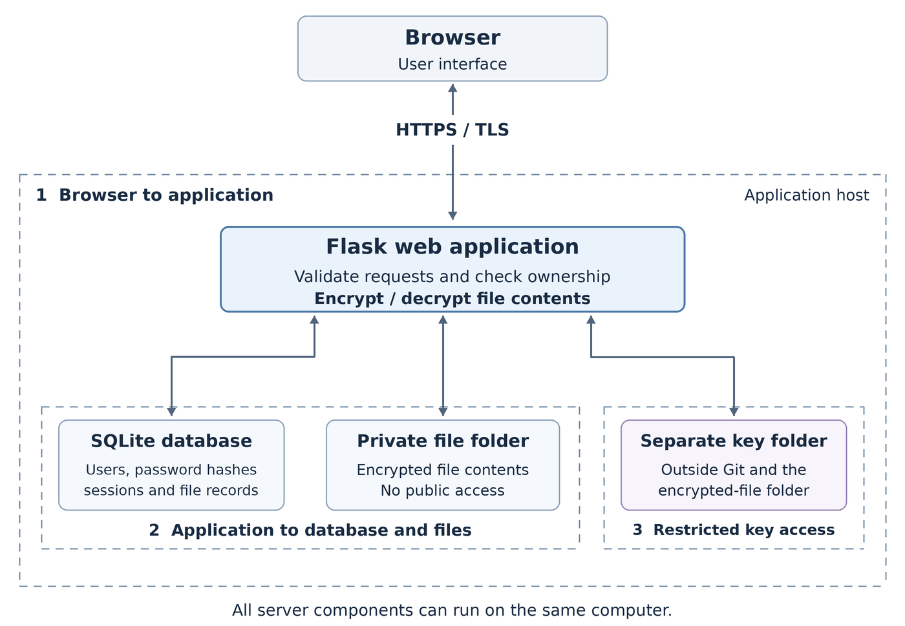

# Checkpoint 1: architecture and threat model

**Secure Web-Based File Encryption and Management System**

ICS0027 Web Application Security

This is the planned design. The application has not been implemented in this version.

## 1. Purpose

The application will let users register, log in and manage their own files through a website. Users will be able to upload, list, download and delete PDF and text files. File contents will be encrypted on the server before storage.

## 2. System architecture

The browser sends requests to the Flask application over HTTPS. Flask handles login, checks permissions and performs file encryption and decryption. It is the only component that accesses the database, stored files and keys.

SQLite will store users, password hashes, sessions and information about each file, including its owner. The actual encrypted file contents will be kept in a private folder. Encryption keys will be stored in a separate restricted folder outside Git and the encrypted-file folder.

The trust boundaries shown in the diagram are:

1. **Browser to application:** requests can be modified by the user, so the server must validate them.
2. **Application to database and files:** the application must check ownership before reading or changing a user's files. Storage is not directly accessible through the website.
3. **Application to keys:** operating-system permissions will restrict access to the key folder. This is a separate folder on the same host, not a separate server.

On upload, Flask will check the user, file type and size, then encrypt the file with a new random key. On download, it will check ownership before decrypting. On deletion, it will remove the stored file, its key and its database record. Permanent removal of copies in backups or on the physical disk is not guaranteed by this design.

The server needs the keys to decrypt files. Therefore, a full compromise of the server could expose file contents.

## 3. Technology choices and TLS

| Component | Choice and reason |
| --- | --- |
| Application | Python with Flask: a small framework with a straightforward request flow. |
| Web pages | HTML with Jinja templates: pages are generated by the server, keeping the interface simple. |
| Database | SQLite with SQLAlchemy: a local database without a separate database service, using parameterized queries. |
| File encryption | The cryptography library with AES-256-GCM: encrypts file contents and detects tampering. |

The first version will run locally. HTTPS will protect communication between the browser and Flask, using a local TLS certificate trusted by the demonstration browser. Public hosting is outside the initial scope.

## 4. Authentication and sessions

Users will register with a username and password. Passwords will be stored as salted Argon2id hashes, not as readable passwords. File encryption keys will be generated separately from login passwords.

After login, session data will stay on the server. The browser will receive a cookie containing a random session identifier. The planned cookie flags are:

- **Secure:** send the cookie over HTTPS.
- **HttpOnly:** prevent JavaScript from reading the cookie.
- **SameSite=Lax:** limit when the browser sends it with cross-site requests.

Sessions will expire after 15 minutes of inactivity or 2 hours in total. The server will generate a new session identifier after login and invalidate the previous one to prevent session fixation. Logout will invalidate the server-side session.

## 5. Main threats and planned mitigations

The mapping uses [OWASP Top 10:2025](https://top10.owasp.org/2025/). It focuses on relevant threats, including the attack classes covered in Weeks 1-4.

| Threat | OWASP category | Planned mitigation |
| --- | --- | --- |
| HTML or JavaScript injected through filenames or user input | A05 Injection | Escape displayed text, restrict executable content with a Content Security Policy and do not preview uploaded files. |
| Changing a file identifier or owner field to access another user's file | A01 Broken Access Control | Determine the user from the server-side session and check file ownership for every operation. |
| Bypassing browser checks to upload an oversized or disallowed file | A06 Insecure Design | Enforce file type and size limits on the server; generate storage names rather than accepting user-supplied paths. |
| SQL injection through login or file requests | A05 Injection | Use parameterized database queries. |
| Another website submitting actions using a user's session | A01 Broken Access Control | Check CSRF tokens on state-changing forms, including login and logout. |
| Password guessing or session fixation | A07 Authentication Failures | Limit login attempts, use Argon2id password hashes and renew the session identifier after login. |
| File contents exposed during transfer or storage | A04 Cryptographic Failures | Use HTTPS in transit and AES-GCM encryption with separate key storage at rest. |

To prevent content spoofing, error messages will use predefined server-controlled text rather than displaying arbitrary messages supplied through a URL.
